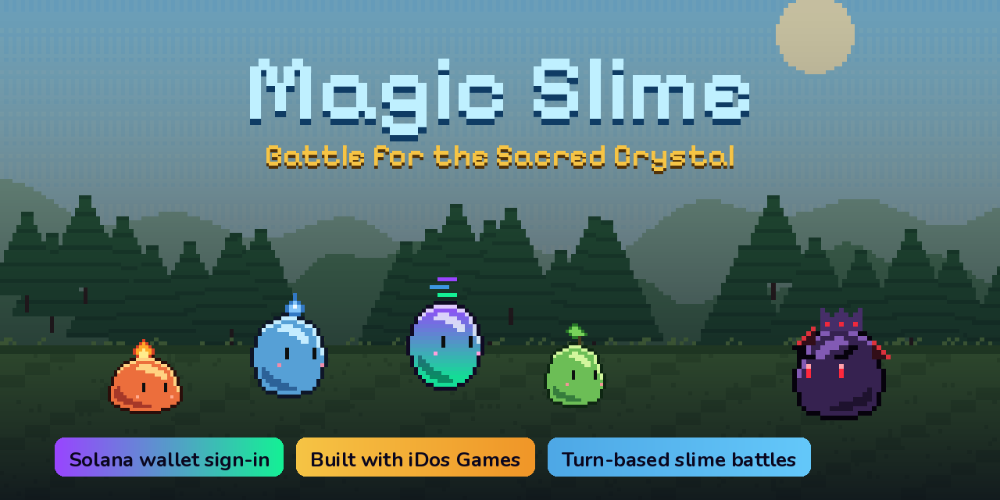
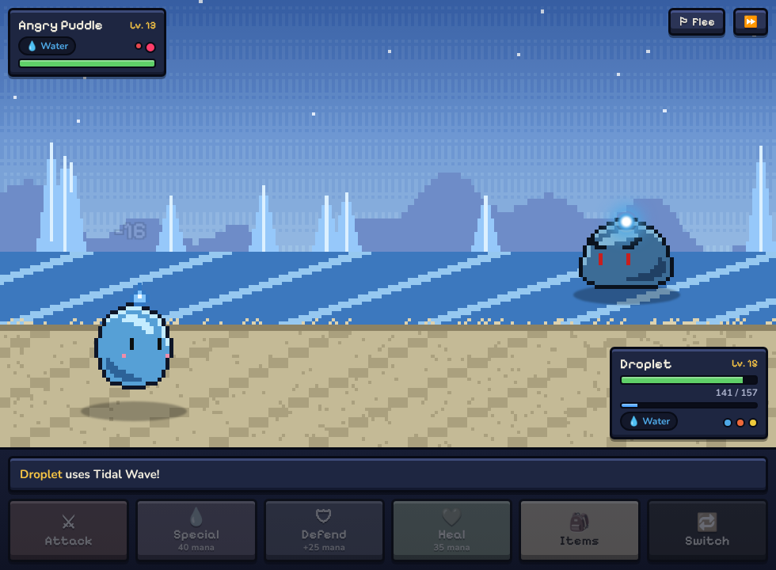
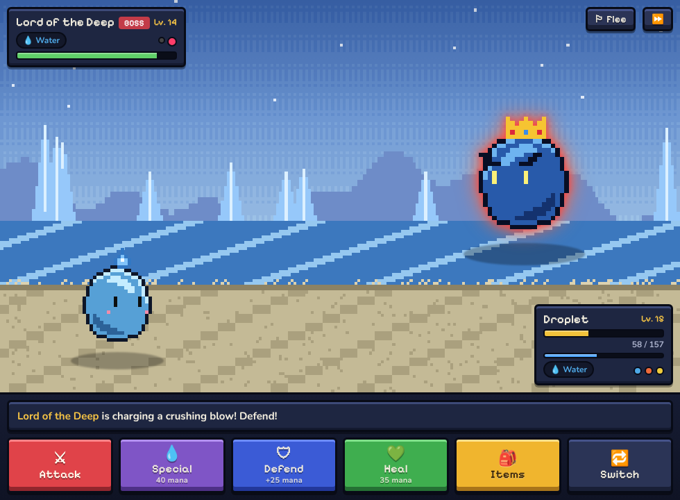
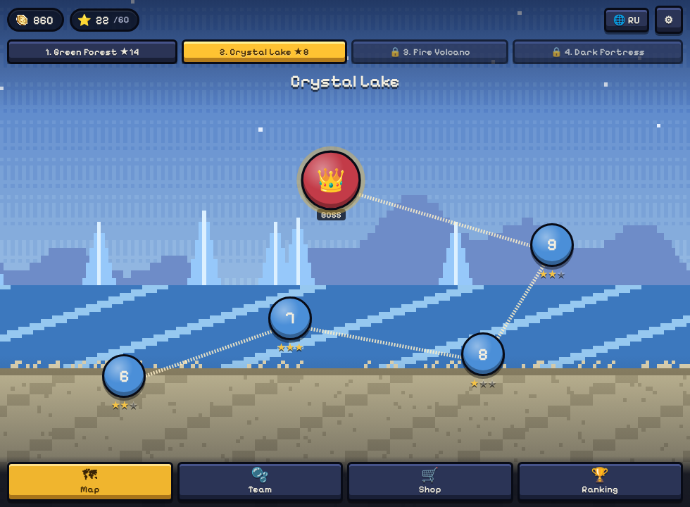
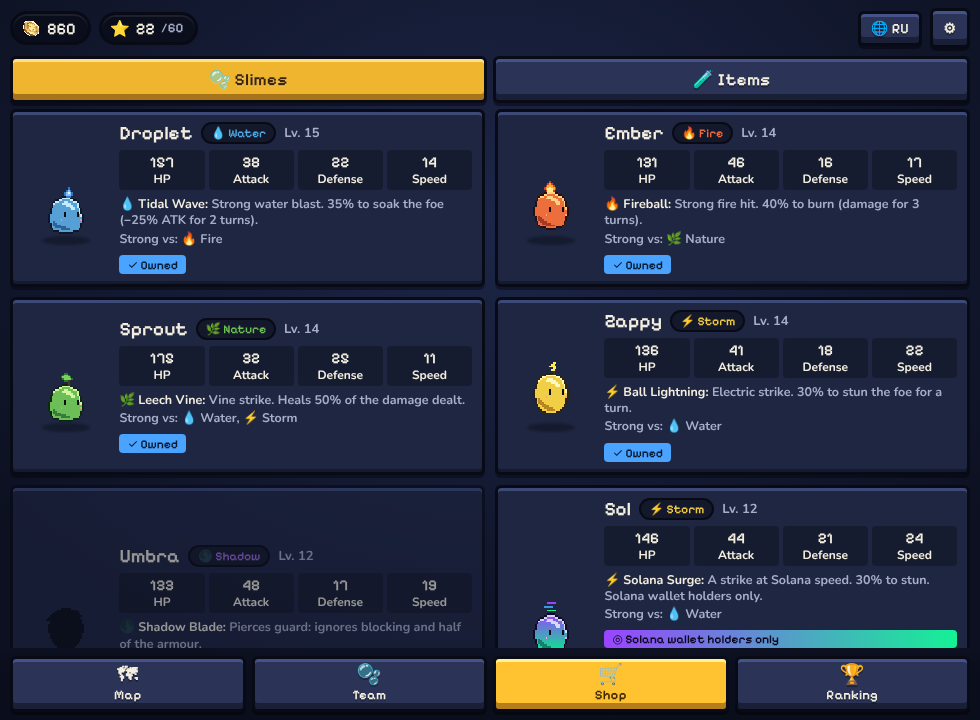
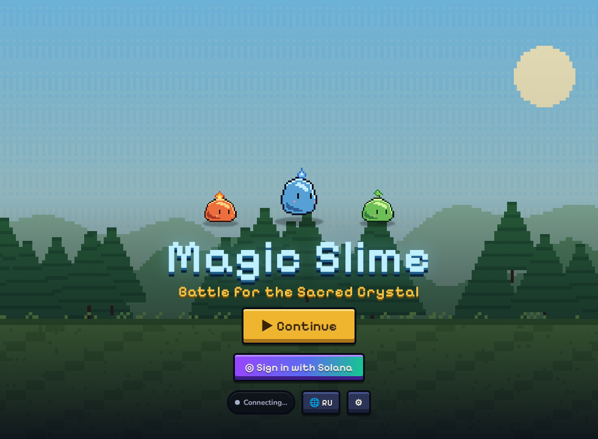
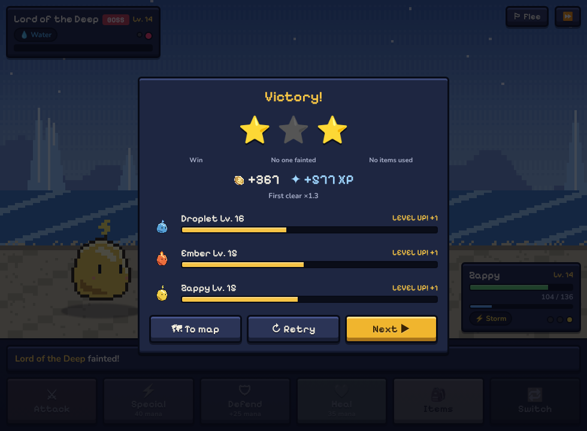

# 🧙‍♂️ Magic Slime: Battle for the Sacred Crystal

---

## 🧩 Short Description
**Magic Slime** is a turn-based, Pokémon-style slime battler built with **iDos Games** and integrated with **Solana**.
Recruit a team of heroic slimes, master the elements and fight your way through four corrupted lands to take the Sacred Crystal back from the Shadow King.
Sign in with your **Solana wallet** to tie your progress to your wallet, unlock the wallet-exclusive slime **Sol** and show your address on the global ranking.

---

## 🖼️ Screenshot / Cover
### 🎨 Cover Art


### 🕹️ In-Game Screenshots
| Battle | Boss charging a crushing blow |
|---|---|
|  |  |

| World map | Shop — wallet-exclusive slime "Sol" |
|---|---|
|  |  |

| Title screen | Victory |
|---|---|
|  |  |

---

## 👤 Team
**Team Name:** 64Bit
**Developer:** Solo Developer — [Samurat Adilet]
- [GitHub](https://github.com/adi2215)
- [LinkedIn](https://www.linkedin.com/in/sam-pixel/)

---

## 🏆 Hackathon Participation
**Event:** iDos Games Hackathon — build a game with iDos Games and a meaningful Solana integration
**Submitted via:** Colosseum · Superteam Earn

---

## 🔗 Resources & Links
- 🎮 **Play Now (iDos Games):** [idosgames.com/app/I5G9YDF8](https://idosgames.com/app/I5G9YDF8/)
- 🌐 **Direct game link:** [i5g9ydf8.idos.games](https://i5g9ydf8.idos.games/)
- 🎥 **Gameplay Video:** _add link_
- 🧠 **Pitch Video:** _add link_
- 🌐 **Social Media:** [Threads](https://www.threads.com/@sampixelstudio)
- 🕹️ **Original Magic Slime (Unity, previous jam):** [adi2215/MagicSlime](https://github.com/adi2215/MagicSlime)

---

## 💡 Problem & Solution
Most blockchain games put the token first and the game second — players are asked to buy, connect and sign before they ever have fun.

**Magic Slime** flips that around:
- The game is **fully playable instantly** — as a guest, no wallet, no download.
- Solana is added **where it actually means something for the player**: identity, ownership of progress, an exclusive collectible and a public on-chain-identity ranking.
- Signing in with a wallet is a single **free signature** — no transaction, no gas.

---

## ⚙️ Key Features
- ⚔️ **Turn-based battles** like in Pokémon: Attack, Elemental Special, Defend, Heal, Items, Switch slime
- 🌈 **6 elements** with a rock-paper-scissors chart (💧 > 🔥 > 🌿 > 💧⚡, ⚡ > 💧, 🌑 ⇄ ✨) and status effects (burn, soak, stun, life-drain, team heal, armour pierce)
- 👑 **Boss fights** with telegraphed charge attacks — read the warning and defend
- 🗺️ **4 lands × 5 stages** (Green Forest, Crystal Lake, Fire Volcano, Dark Fortress) and up to **3 stars per stage**
- 🫧 **7 slimes to collect** — 6 bought with gold as you progress, plus the **Solana-exclusive "Sol"**
- 📈 Slimes level up from battles; train them with gold; buy potions, mana elixirs and revive apples
- ☁️ **Cloud save** and **global leaderboard** through iDos Games
- 🌐 **English / Russian**, auto-detected, switchable in one tap
- 📱 Works on phones and desktop, inside the idosgames.com page or by direct link
- 🎨 Pixel art and music from the original Magic Slime, recoloured into a whole cast of slimes

---

## ◎ Solana Integration
All Solana features go through the **iDos Games** platform (title `I5G9YDF8`, `Blockchain.WalletLogin` enabled, network `solana`).

| Feature | How it works |
|---|---|
| **Wallet authentication** | The player signs the engine's login challenge with **Phantom / Solflare / Backpack** (`loginWithWalletSolana` from `@idosgames/wallet`). Inside the idosgames.com iframe the **site's own Solana wallet** signs it (`loginWithWalletViaPlatform`). The server verifies the ed25519 signature and the account becomes the wallet's account — no transaction, no fees. |
| **Progress owned by the wallet** | Cloud save (`UserCustomData`) is bound to the wallet account, so the same progress follows the player to any device by signing in with the same wallet. Guest progress is merged on first wallet sign-in. |
| **Wallet-exclusive collectible** | **Sol** — a Solana-coloured storm slime with the *Solana Surge* move — can only be recruited after the server-verified wallet sign-in (`client.blockchain.getUserState()` → verified address). |
| **Leaderboard with Solana identities** | Scores go to the iDos leaderboard `ms_progress`; players who signed in with a wallet show their address (`◎ 7xKX…gAsU`) next to their name. |

---

## 🧰 Tech Stack
- **Language:** TypeScript
- **Platform:** iDos Games (`@idosgames/core`, `@idosgames/wallet`)
- **Blockchain:** Solana (wallet sign-in via iDos)
- **Build:** Vite, plain DOM + CSS (no engine — instant load on mobile)
- **Tools:** Python + Pillow (sprite recolouring and procedural pixel backgrounds), Playwright (UI tests), balance simulator

---

## 🏗️ Project Architecture
```
src/
  engine.ts      Pure turn-based battle engine (no DOM) — actions, damage, statuses, enemy AI
  data.ts        Elements, slimes, enemies, bosses, zones/stages, items, progression curves
  battleView.ts  Battle screen: plays engine events as animations (lunges, orbs, damage numbers)
  screens.ts     Title, world map, team, shop, ranking, settings
  game.ts        Rewards, stars, shop, training, team management
  save.ts        Local + cloud save with merge
  idos.ts        iDos Games SDK: login, cloud save, leaderboard, Solana sign-in
  solana.ts      Wallet detection and iDos wallet-login flows
  i18n.ts        English / Russian strings
tools/
  make_sprites.py  Builds every slime/enemy/boss sheet from the original slime frames
  make_bg.py       Procedural pixel backgrounds for the 4 lands
  sim.ts           Plays the whole campaign thousands of times to tune difficulty
```

---

## 🚀 Quick Start
🎮 **Play Now:** [Magic Slime on iDos Games](https://idosgames.com/app/I5G9YDF8/)

1. Open the game — you can start playing right away as a guest
2. Press **◎ Sign in with Solana** and sign the message in your wallet (free, no transaction)
3. Claim **Sol** in the shop, build your team and free the four lands

### Run locally
```bash
npm install
npm run dev        # http://localhost:5173
npm run build      # static build in dist/ (upload to iDos Games)
npm run sim        # balance simulation
npm run assets     # regenerate sprites and backgrounds (Python + Pillow)
```

---

### 🪄 "Play as the Slimes. Save the World."
